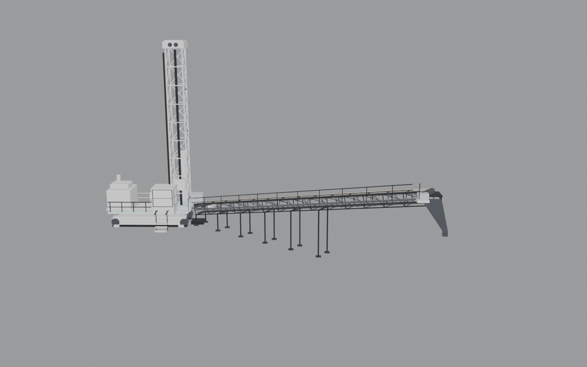

# SUPPRESS_v3h — merged-face suppression for `mine_revamp_c9a9394e.glb`

Written Saturday 7 Nov 2026, 2:02 PM PT (America/Los_Angeles).
Documentation and evidence only. No new art. Study blends were not written. Nothing was written to the repo, `/dev`, live, `qa3d`, or any served folder. Scratch and deliverables live in this folder.

`CURRENT_ASSETS.md` was read. Fresh live downloads matched the register:

| md5 | file |
|---|---|
| b1ef349758e9e396fab630f0308088d4 | live `main.js?v=dev1308` (index base `../qa3d/`) |
| c9a9394e3635f99f59423a4630ae6ae7 | `mine_revamp_c9a9394e.glb` |
| a4a2a4d2cb67f89310f34005a9a40057 | `mine_terrain_v3b_a4a2a4d2.glb` |
| 205f8acb4897c5df312b57e2d07fb12e | `all_truck_trails_205f8acb.glb` |
| 76e02e8b1341c17dae0362d13eec0c74 | `ht04_76e02e8b.glb` |
| 2cfa57a6ec0ad8e9ca566a4e068b2310 | `mine_operator_9209246.glb` |

Machine-readable copy of the boxes and counts: [`suppress_v3h.json`](suppress_v3h.json).
Documentation-only Three.js snippet: [`suppress_v3h_filter_example.js`](suppress_v3h_filter_example.js).

This note corrects `EXPORT_v3h.md`: keeping `Base_Paint` and `Base_GlowCyan` without the filter below resurrects the old hopper, silo, supports, pad and scrap that v3+ deleted from those merged meshes. Named-node hides alone are not enough.

## 1. How v3 hid those faces

Not by material, and not by connected-island walk. The authoring predicate is a **world-space face-centroid AABB test**, implemented as `cut_faces_in_box` in `build_drill_concept_v3.py` (and the same helper in the v1 and v2 builders).

For each face, average the world positions of its vertices (`obj.matrix_world @ v.co`). Delete the face if that centroid is inside an inclusive box `(xmin ≤ x ≤ xmax and ymin ≤ y ≤ ymax and zmin ≤ z ≤ zmax)`. Boxes were authored in **Blender axes** after the glTF import (`blender(x, y, z) = gltf(x, −z, y)`).

v3 (a copy of already-cut v2) applied two more boxes to every mesh whose **parent name starts with** `Base_Paint` or `Base_GlowCyan`:

```
# hopper cone+legs+pipe, silo/dome, chute supports, leftover teal near hopper foot.
# Everything plant-side of the drill (x > -5.40). Do not cut drill-side leftovers.
PLANT = (-5.40, 14.20, -12.20, 10.20, -0.30, 9.90)
TEAL  = (-5.80,  1.80,  -1.50,  6.60,  0.20,  2.40)
```

v1 had already cut `DERRICK_BOX`, `DERRICK_TALL`, `PAD_BOX` (merged derrick / part of the circular pad). v2 had already cut `PAD_A`, `PAD_B`, `SCRAP` (rest of the pad and drill-side scrap). v3f/v3g/v3h copied that already-cut mesh forward and did not recut.

Read-only check of the study blends (not saved):

| blend | `Mesh_1` under `Base_Paint` | `Mesh_0` under `Base_GlowCyan` |
|---|---:|---:|
| `mine_drill_concept_v3.blend` | 315 faces / 316 verts | 0 faces / 0 verts |
| `mine_drill_concept_v3h.blend` | 315 faces / 316 verts | 0 faces / 0 verts |

## 2. Mapping onto the served GLB as Three.js decodes it

Served file: `mine_revamp_c9a9394e.glb` md5 `c9a9394e3635f99f59423a4630ae6ae7`, extensions `EXT_meshopt_compression` + `KHR_mesh_quantization`, no Draco.

| parent node | served node | child | mesh / prim | material | decoded verts | decoded tris |
|---|---:|---:|---|---|---:|---:|
| `Base_GlowCyan` | 12 | node 0 | mesh 0 / prim 0 | `SHM_GlowCyan` | 1932 | 1874 |
| `Base_Paint` | 13 | node 1 | mesh 1 / prim 0 | `SHM_Paint` | 7056 | 8305 |

Mesh names are null. In Three.js the drawable is the unnamed `Mesh` child of the named empty (`scene.getObjectByName('Base_Paint').children[0]`). Parent empties and children have identity transforms, so local == world == glTF +Y-up. Still multiply by `mesh.matrixWorld` so a later scene offset stays correct.

Positions on these primitives are meshopt `ATTRIBUTES` + `EXPONENTIAL` filter, accessor componentType 5126 (float32). `KHR_mesh_quantization` does not rescale them. Indices are meshopt `TRIANGLES` mode, accessor 5123 (uint16), 0-based per primitive (glow `[0, 1931]`, paint `[0, 7055]`). Shared meshopt views are sliced by accessor `byteOffset` (paint positions start at byte 23184 = 1932 × 12; paint indices start at byte 11244 = 5622 × 2).

**Decode used here:** `meshoptimizer` 1.2 `MeshoptDecoder.decodeGltfBuffer` — the same decoder and arguments `THREE.GLTFLoader`’s `GLTFMeshoptCompression.loadBufferView` calls. That is the vertex and index order GLTFLoader produces from the official packed bytes.

**`gltfpack -noq` does not preserve that order.** `gltfpack 1.3 -noq -kn -km -ke` of the official file keeps the same triangle *set* (0 triangles unique to either side) but reorders vertices and indices, and welds 7 `Base_Paint` verts (7056 → 7049). A raw list of triangle slots taken from a `-noq` unpack (or from any future re-pack / re-quantize) would delete the **wrong** triangles in GLTFLoader.

### Recommended recipe

**World-space centroid vs the union of the eight AABBs below** (the two v3 boxes plus the six v1/v2 boxes). Drop a triangle if its centroid is inside *any* box (inclusive).

Why this, not the alternatives:

- It is the original `cut_faces_in_box` predicate, just expressed in glTF axes.
- It is stable across meshopt decode, `gltfpack -noq`, and any later re-pack.
- A connected-island list is unnecessary — the authored boxes already isolate the plant, pad, derrick and scrap.
- A split would be a new art export, which this pass does not do.
- **Do not ship raw triangle-index masks.** They are valid only for a MeshoptDecoder/GLTFLoader decode of this exact served md5, and they are invalid after `gltfpack -noq` or any re-pack.

Applying only the two v3 boxes (`PLANT ∪ TEAL`) on the *raw served* mesh is not enough to match the study: it leaves the old derrick, circular pad and drill-side scrap that v1/v2 already removed.

## 3. AABBs (glTF / Three.js, +Y up) and triangle counts

`gltf(x, y, z) = blender(x, z, −y)`. Each box below is `min` / `max` in glTF coordinates.

| box | layer | min (x, y, z) | max (x, y, z) | paint tris (independent) | glow tris (independent) |
|---|---|---|---|---:|---:|
| `PLANT` | v3 | −5.40, −0.30, −10.20 | 14.20, 9.90, 12.20 | 4750 | 1164 |
| `TEAL` | v3 | −5.80, 0.20, −6.60 | 1.80, 2.40, 1.50 | 337 | 219 |
| `DERRICK_BOX` | v1 | −11.20, 0.05, −6.40 | −4.50, 18.5, −1.40 | 1073 | 582 |
| `DERRICK_TALL` | v1 | −11.20, 3.80, −6.40 | −3.70, 18.5, −1.40 | 202 | 181 |
| `PAD_BOX` | v1 | −9.70, −0.06, −5.40 | −5.30, 0.85, −1.90 | 277 | 174 |
| `PAD_A` | v2 | −14.70, −0.35, −6.90 | −5.10, 1.20, 4.40 | 1730 | 474 |
| `PAD_B` | v2 | −13.40, −0.35, −1.52 | −5.10, 1.50, 4.40 | 1104 | 238 |
| `SCRAP` | v2 | −12.40, 1.00, −6.80 | −5.20, 6.40, 1.10 | 1520 | 424 |

Independent per-box counts overlap, so they do not sum to the union.

### Count reconciliation (4641 / 1041)

The remembered “v3 hid 4641 `Base_Paint` faces and 1041 `Base_GlowCyan` faces” is the **incremental** `V3_PLANT_CUT` (`PLANT ∪ TEAL`) after v3 ran on the already-cut v2 blend — not the raw served primitives.

| | `Base_Paint` | `Base_GlowCyan` |
|---|---:|---:|
| served triangles (meshopt / Three.js decode) | 8305 | 1874 |
| `PLANT ∪ TEAL` on the raw served mesh | 4773 | 1197 |
| of those also inside a v1/v2 box (already gone before v3 ran) | 132 | 155 |
| incremental v3 cut (`v3_only`) | **4641** | **1042** |
| remembered incremental | 4641 | 1041 |
| recommended full union (v1 ∪ v2 ∪ v3) | **7990** | **1874** |
| remaining after full union | **315** | **0** |

Paint 4641 matches exactly (4773 − 132). Glow is **1042, not 1041**. The extra glow triangle is slot 669 in the Three.js-decoded `Base_GlowCyan` primitive. Its centroid is `(−5.0824, 1.2904, −1.3971)` in glTF coordinates, 2.9 mm outside `DERRICK_BOX` (the nearest prior box). A Blender import of a `gltfpack -noq` unpack — which the authoring pipeline used, because Blender 4.2 cannot decode meshopt — can nudge that centroid across the box face, so the logged `V3_PLANT_CUT` glow total can read 1041. Apply the AABB test, not a hardcoded 1041.

After the recommended full union, `Base_GlowCyan` is empty (matches `Mesh_0` in the v3/v3h blends). Hiding the `Base_GlowCyan` node is visually equivalent. `Base_Paint` keeps 315 triangles: a low drill-side ground skirt whose centroids sit in glTF AABB roughly `x[−12.07, −5.43], y[−0.05, 0.60], z[−9.02, −6.90]` — outside the pad boxes, not hopper/silo.

## 4. Tiny reference snippet (documentation only)

See [`suppress_v3h_filter_example.js`](suppress_v3h_filter_example.js). The filter walks `geometry.index` in steps of 3, transforms the three positions by `mesh.matrixWorld`, drops the triangle if the centroid is inside any AABB, and writes the kept index list back with `setIndex`.

Expected remainder after the full union: `{ Base_Paint: 315, Base_GlowCyan: 0 }`.

## 5. Named hides that the face filter does not replace

`EXPORT_v3h.md` already lists `Rig`, `Drill_Pocket`, `Dust`, `Conveyor`, `OrePath_Bin_00`–`10`, `Chute` / `Chute_Glow` / `Chute_Exit`, `Silo` / `Silo_BinFill`, `OrePath_Silo_00`–`06`, `Deposit_01` / `Deposit_02`, `Rich_Pop`. Do not match `Conveyor` with `startswith` — that would also hit the new `Conveyor_Gallery`.

**Tiers must also be hidden to match the v3+ study and the v3h concept stills.** v1 (`build_drill_concept.py` `HIDE_NODES`) hid `Tier_03`, `Tier_05`, `Tier_08`, `Tier_12`, `Tier_20` as served-base / Lv 1 upgrades, and every later study blend kept them hidden. They are not merged into `Base_Paint`:

| node | imported child | what it is |
|---|---|---|
| `Tier_05` | `Mesh_6` (1183 tris) | visual hopper (cone + legs) |
| `Tier_12` | `Mesh_8` (685 tris) | upgraded silo |
| `Tier_20` | `Mesh_9` (284 tris) | tall old derrick cap (blender Z 13.53–21.78 at the old Rig XY) |
| `Tier_03` | `Mesh_5` (210 tris) | earlier elevated conveyor / gallery tier |
| `Tier_08` | `Mesh_7` (272 tris) | west-side upgrade building |

`EXPORT_v3h.md` said to keep the Tiers as site infrastructure. Following that line after the face filter still leaves the hopper and silo in game (evidence: `suppress_v3h_over_mine_export_hides_only.png`).

## 6. Eye-check

Box-locked EEVEE stills, same GameCam as the export overlay (`(2.0, −45.34, 14.98)` looking at `(1.5, −6.0, 5.5)`, vertical 32°). Served Mine unpacked with `gltfpack -noq -kn -km -ke` (Blender 4.2 cannot decode meshopt), AABB cut applied with the original blender-space boxes, named hides including the five Tiers, then `mine_drill_v3h.glb` imported. Cut counts in that Blender session: paint removed 7990 remain 315; glow removed 1874 remain 0 — same as the meshopt/Three.js decode.



Plant-side companion: `suppress_v3h_plant_side.png`.

**Result: PASS** for old pad scraps, hopper, silo, derrick and plant-support fragments. What remains is the v3h crawler, lattice mast, cab, gallery, supports and funnel. No second white derrick, no cone-on-legs hopper, no tank silo, no circular pad. The 315 leftover `Base_Paint` triangles do not read as plant.

Contrast, same camera, **without** the Tier hides (EXPORT named-node list only): `suppress_v3h_over_mine_export_hides_only.png` — hopper (`Tier_05`) and silo (`Tier_12`) are still there. That is why the Tiers have to go on the hide list.

## Files in this folder

| path | role |
|---|---|
| `SUPPRESS_v3h.md` | this note |
| `suppress_v3h.json` | boxes, counts, decode notes |
| `suppress_v3h_filter_example.js` | documentation-only Three.js snippet |
| `suppress_v3h_over_mine.png` | primary verification still (study-matching hides) |
| `suppress_v3h_plant_side.png` | plant-side companion |
| `suppress_v3h_over_mine_export_hides_only.png` | same scene if Tiers are kept |
| `suppress_v3h_plant_side_export_hides_only.png` | plant-side companion of the above |
| `mine_revamp_c9a9394e_noq.glb` | scratch `gltfpack -noq` unpack (order ≠ GLTFLoader) |
| `mine_drill_v3h_noq.glb` | scratch unpack of the official v3h GLB, for the overlay only |
